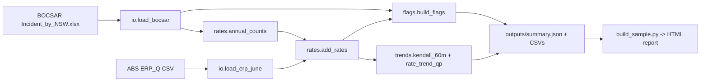

> **Proprietary - All Rights Reserved.** Licensed to Sandeep Grover. No reuse, copying, modification, or distribution without prior written permission. See LICENSE. Third-party public data in `data_raw/` keeps its own CC BY 4.0 licence (see NOTICE).

# NSW Crime Trends

A small, runnable pipeline that turns police-recorded crime counts into population-adjusted rates and defensible trend statements. It uses real public data: BOCSAR's monthly recorded criminal incidents for all of NSW (62 offence series, Jan 1995 to Jun 2026) and the ABS quarterly Estimated Resident Population.

## What it does

1. **Ingest** (`src/nsw_crime_trends/io.py`): reads the BOCSAR workbook's `Data` sheet with openpyxl (values only, macros never run) and the ABS ERP_Q CSV. Murder and manslaughter rows carry BOCSAR's asterisk and are tagged `victims`; all other rows are `incidents`. Blank cells stay missing, never 0.
2. **Annual totals and rates** (`rates.py`): calendar-year totals per offence, kept only when that offence has all 12 months present (incomplete series-years are listed in `summary.json -> excluded_series_years`). Rate per 100,000 = count / June ERP of the same year x 100,000.
3. **Trends** (`trends.py`):
   - `kendall_60m`: our reimplementation of the BOCSAR convention: Kendall's tau-b on the last 60 monthly counts, p < 0.05, no test if any 12-month total is below 20, average annual change from first and last 12-month totals.
   - `rate_trend_qp`: quasi-Poisson regression of annual counts with a log(ERP) offset over 2016-2025, giving the annual percent change in the rate with a t-based 95% CI (Pearson scale absorbs over-dispersion). A sensitivity run excludes 2020-2021.
4. **Flags** (`flags.py`): `COUNTING_UNIT`, `NEW_SERIES` (zeros until a start month), `POLICING_SENSITIVE` (offences BOCSAR describes as mainly police-detected), `LEVEL_SHIFT` (robust z >= 3.5 and >= 50% year-on-year change), `MISSING_MONTHS`. Flags never alter data; they mark where a change may come from counting or recording rather than offending.
5. **Report** (`build_sample.py` + `sample_template.html`): renders the dark-theme HTML sample. Every number on the page is read from `outputs/summary.json`.



## Run

```bash
python3 -m venv .venv && . .venv/bin/activate
pip install -r requirements.txt
python3 -I main.py --bocsar data_raw/Incident_by_NSW.xlsx --erp data_raw/ABS_ERP_Q_NSW_persons.csv --out outputs
python3 -I build_sample.py --summary outputs/summary.json --out sample.html --retrieved 2026-10-20
python3 -m pytest tests -q
```

Tested with Python 3.11.14, pandas 3.0.6, numpy 2.4.6, scipy 1.17.1, statsmodels 0.14.6, openpyxl 3.1.5, pytest 9.1.1 (11 tests).

## Outputs

- `outputs/annual_counts_rates.csv`: offence x year counts, ERP and rate per 100,000
- `outputs/trend_summary.csv`: one row per offence with both trend tests, sensitivity run and flags
- `outputs/summary.json`: everything the HTML report reads, plus input file hashes

## Data provenance and licences

| File | Publisher | Licence | Retrieved |
|---|---|---|---|
| `data_raw/Incident_by_NSW.xlsx` | NSW Bureau of Crime Statistics and Research (BOCSAR), https://bocsar.nsw.gov.au/content/dam/dcj/bocsar/documents/open-datasets/Incident_by_NSW.xlsx | CC BY 4.0 (DCJ copyright statement) | 2026-10-20 |
| `data_raw/ABS_ERP_Q_NSW_persons.csv` | Australian Bureau of Statistics, ABS Data API ERP_Q, https://data.api.abs.gov.au/rest/data/ABS,ERP_Q,1.0.0/1.3.TOT.1.Q?startPeriod=1994-Q1 | CC BY 4.0 | 2026-10-20 |

Attribution: Source: NSW Bureau of Crime Statistics and Research, Recorded Criminal Incidents by month (All of NSW); Australian Bureau of Statistics, Quarterly Population Estimates (ERP). Both licensed under CC BY 4.0. No endorsement by BOCSAR, ABS or the State of NSW is implied. SHA-256 hashes are in `data_raw/PROVENANCE.md` and NOTICE.

## Limits

Recorded crime covers incidents reported to or detected by NSW Police and recorded on COPS; unreported crime is absent. Trend results are descriptive and say nothing about causes. Level-shift flags are statistical prompts for a manual check against BOCSAR notes, not confirmed definition changes.
